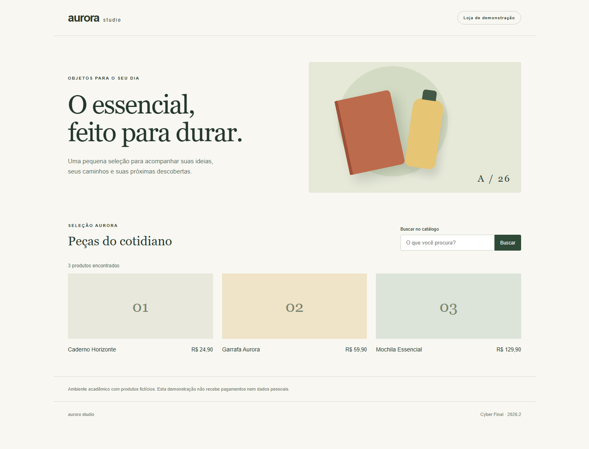

# Avaliação final de Cibersegurança 2026.2

Projeto novo para a avaliação final, na conta acadêmica já utilizada no curso. A conta e serviços de suporte podem ser aproveitados conforme a autorização do aluno, preservando o trabalho anterior. A proposta usa uma loja fictícia chamada **Aurora** como aplicação de demonstração, com catálogo sintético, banco privado, VPN, WAF e monitoramento. O nome e os detalhes do negócio são premissas de trabalho; as imagens do enunciado citam ABC Place na estrutura sugerida.

**Situação:** aplicação e configuração de infraestrutura preparadas. O ambiente AWS ainda não foi criado. As capturas disponíveis mostram a aplicação local. Não há comprovação de VPN, WAF ou Wazuh funcionando na nuvem nesta etapa.

**Restrição autorizada:** nenhum desembolso pessoal do aluno. A criação depende de conferir a cobertura da conta acadêmica. Não excluir, parar ou substituir os recursos do trabalho anterior. [Limites de uso da conta existente](docs/limites-da-conta-existente.md).

## Conteúdo

- [Requisitos e pesos da avaliação](docs/criterios-da-avaliacao.md)
- [Arquitetura proposta](docs/arquitetura.md)
- [Matriz de riscos inicial](docs/matriz-de-riscos.md)
- [Custos e decisões para implantação](docs/custos-e-implantacao.md)
- [Plano de evidências e capturas](docs/plano-de-evidencias.md)
- [Procedimentos de implantação e validação](docs/operacao.md)
- [Roteiro da apresentação de 12 slides](docs/roteiro-apresentacao.md)
- [Pendências da entrega](docs/status.md)

## Executar a demonstração local

Requer Python 3.10 ou superior, sem dependências externas no modo local.

```powershell
python app/server.py --demo
```

Abrir `http://127.0.0.1:8080`. O modo local usa um catálogo em memória; o caminho AWS utiliza MySQL com TLS e Secrets Manager. A aplicação não recebe pagamentos nem dados pessoais.

```powershell
python -m unittest discover -s tests -v
terraform -chdir=infra init -backend=false
terraform -chdir=infra validate
terraform -chdir=infra test
```

Os testes Terraform usam provedores simulados. Eles verificam propriedades da configuração, sem criar recursos ou comprovar o funcionamento de serviços AWS.

## Organização

| Pasta | Conteúdo |
| --- | --- |
| `app` | Aplicação nova, com busca parametrizada e cabeçalhos de segurança |
| `infra` | Infraestrutura Terraform, instalação inicial e testes de configuração |
| `scripts` | Capturas locais, teste controlado de WAF e manifesto de integridade |
| `tests` | Testes da aplicação |
| `docs` | Arquitetura, riscos, procedimentos e apresentação |
| `evidencias/locais` | Capturas e resultados produzidos neste projeto no computador |
| `evidencias/atuais` | Reservada às provas reais do novo ambiente AWS |
| `entrega` | Reservada ao relatório, matriz e slides finais após validação prática |

Chaves, senhas, perfis VPN, arquivos de estado e dados de trabalho privados são excluídos do Git. A entrega deve identificar o que foi criado nesta avaliação e produzir evidências atuais dos controles utilizados. Os recursos e arquivos dos trabalhos anteriores serão preservados.


