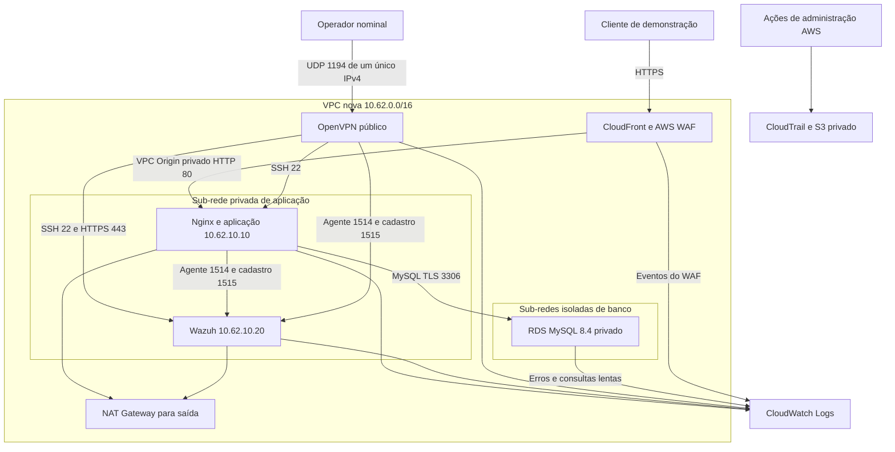

# Arquitetura implantada

Configuração nova implantada em 21/11/2026, identificada como cyberfinal262-5f48e9. O cenário é uma loja acadêmica de catálogo, sem pagamentos ou dados pessoais. A separação dos componentes permite demonstrar os controles exigidos no enunciado com ações de teste limitadas ao laboratório.

## Componentes e decisões

| Componente | Configuração implantada | Finalidade |
| --- | --- | --- |
| VPC | Rede nova e seis sub-redes em duas zonas | Isolar o laboratório |
| Aplicação | EC2 t3.micro privada, Nginx e serviço sem usuário root | Manter a origem fora da Internet |
| Banco | RDS MySQL 8.4, db.t4g.micro, disco criptografado e backup de 7 dias | Separar aplicação e dados |
| VPN | EC2 t3.micro, certificados próprios e UDP 1194 restrito a /32 | Administrar os destinos privados |
| Monitoramento | Wazuh em EC2 t3.xlarge, disco de 50 GB | Agentes, eventos, FIM e inventário de vulnerabilidades |
| Borda | CloudFront com VPC Origin e AWS WAF | Entrada pública HTTPS e inspeção das requisições |
| Saída | Um NAT Gateway | Atualizações e comunicação com APIs |
| Auditoria | CloudTrail, Flow Logs e CloudWatch | Rastrear ações, conexões e serviços |

O Wazuh recomenda 4 vCPU, 8 GiB de RAM e 50 GB para até 25 agentes; a instância implantada tem 4 vCPU e 16 GiB. [Requisitos oficiais](https://documentation.wazuh.com/current/quickstart.html).

O VPC Origin permite alcançar a EC2 privada pelo CloudFront, com um ponto de entrada público separado da aplicação. A rede ainda precisa de Internet Gateway conforme os pré-requisitos do serviço. [Documentação AWS](https://docs.aws.amazon.com/AmazonCloudFront/latest/DeveloperGuide/private-content-vpc-origins.html).

## Regras de comunicação

| Origem | Destino | Porta | Restrição |
| --- | --- | --- | --- |
| IPv4 do operador | VPN | UDP 1194 | Somente um endereço /32 |
| CloudFront | Web privado | TCP 80 | Prefix list oficial e VPC Origin |
| VPN | Web e Wazuh | TCP 22 | Referência ao Security Group da VPN |
| VPN | Wazuh | TCP 443 e 55000 | Painel e API em rede privada |
| Web e VPN | Wazuh | TCP 1514 e 1515 | Eventos e cadastro dos agentes |
| Web | RDS | TCP 3306 | Somente Security Group Web, com TLS obrigatório |
| Instâncias | Repositórios e APIs | TCP 443 e 80 | Saída para APIs TLS e repositórios com pacotes assinados |

## Identidades e segredos

O operador utiliza conta nominal e chave SSH nova. O acesso direto SSH de root e a autenticação por senha são desabilitados. A aplicação executa como `cyberapp` e usa `catalog_reader`, com SELECT apenas no catálogo. O usuário nominal de operação pode elevar privilégios com sudo, registrando suas ações.

As instâncias utilizam roles, sem chaves AWS gravadas na aplicação. O segredo privilegiado do RDS só é permitido ao bootstrap Web durante duas horas após a criação do banco; ele cria o usuário restrito e não salva a senha privilegiada em disco. O segredo da aplicação é recuperado por API. O estado Terraform deve ser tratado como confidencial, pois contém o segredo gerado para a aplicação.

## Limites que precisam aparecer na entrega

- Duas zonas não tornam a aplicação altamente disponível: há um servidor Web, um Wazuh e um NAT; o RDS está em Single-AZ para uso acadêmico.
- CloudFront usa HTTPS público. O trecho privado VPC Origin–Nginx usa HTTP; não se deve afirmar criptografia TLS ponta a ponta.
- O certificado padrão `cloudfront.net` mantém a política mínima TLSv1 no serviço. Para exigir TLS 1.2, configurar domínio e certificado ACM em us-east-1 e testar os protocolos. [Comportamento documentado pela AWS](https://docs.aws.amazon.com/AmazonCloudFront/latest/DeveloperGuide/DownloadDistValuesGeneral.html).
- O painel Wazuh usa vitor em leitura. A conta de bootstrap foi utilizada apenas para inicializar as visualizações.
- As regras de cadastro de agentes estão limitadas aos servidores previstos. Autenticação adicional de enrollment deve ser revisada antes da entrega.
- Alarmes e painel estão configurados no CloudWatch; envio de notificação externa não foi configurado nem testado.
- Logs de erros e consultas lentas do RDS não equivalem a auditoria completa de todas as consultas.
- O snapshot foi restaurado em cópia privada, com três registros e SHA-256 igual. A cópia temporária foi removida após o teste.
