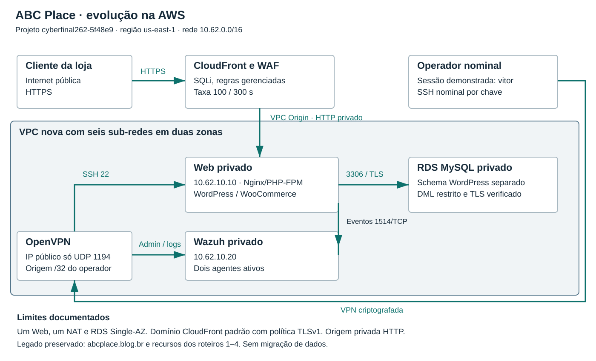

# Arquitetura da evolução ABC Place

Projeto `cyberfinal262-5f48e9`, região us-east-1, VPC nova `10.62.0.0/16` com seis sub-redes em duas zonas. O diagrama corresponde aos recursos novos da avaliação final.

Internet → CloudFront/AWS WAF → VPC Origin HTTP → Nginx/PHP-FPM/WordPress/WooCommerce → RDS MySQL 8.4 com TLS. Web `10.62.10.10` e Wazuh `10.62.10.20` não têm IP público. O RDS é privado, criptografado, Single-AZ, com backup de sete dias e proteção contra exclusão. Web e Wazuh usam UFW; o SG do banco aceita 3306 apenas do Web.

O WordPress usa o schema `abcplace_wp` e usuário `abcplace_web`, com SELECT/INSERT/UPDATE/DELETE apenas nesse schema. A conta temporária de setup foi excluída. O drop-in de banco exige CA RDS e verificação do servidor; testes negativos com CA incorreta e hostname inválido falharam. O tema e o plugin de modo acadêmico estão em `wordpress/`. Checkout, cadastro público, edição de arquivos pela interface e API pública foram restringidos. A administração é por WP-CLI via sessão nominal, SSH e VPN; `/wp-admin` e `/wp-login.php` públicos recebem 403.

O catálogo Python anterior continua em 127.0.0.1:8080 e mantém `/healthz` e `/api/products` como módulo técnico. Seu usuário `catalog_reader` tem somente SELECT em `cyberfinal.products`. Ele não substitui WordPress/WooCommerce na avaliação da aplicação principal.

A VPN recebe UDP 1194 da origem /32 e oferece apenas as rotas administrativas definidas. Wazuh recebe eventos dos agentes Web e VPN, incluindo FIM na árvore WordPress. RDS gerenciado não recebe um agente de SO; a cobertura é feita pelos recursos AWS. Logs da AWS e do SIEM não são tratados como um único fluxo totalmente integrado quando isso não foi testado.

## Relação com o ambiente dos roteiros

O legado usa WordPress/Apache, EC2 de banco, Cloudflare em `abcplace.blog.br`, Wazuh e a VPN do Roteiro 4. Esses recursos foram preservados. A nova VPC é uma evolução paralela: não existe peering com o legado, não houve troca de DNS nem migração de clientes, pedidos, uploads ou configurações antigas.

## Limites

Há um único Web, NAT e RDS. Sub-redes em duas zonas não tornam esses serviços redundantes. O domínio padrão CloudFront mantém política mínima TLSv1 e o trecho privado CloudFront–Nginx usa HTTP. O certificado do Wazuh é privado de instalação. MFA e notificação externa dos alarmes novos continuam sem comprovação. O resultado não é aprovação de produção.
